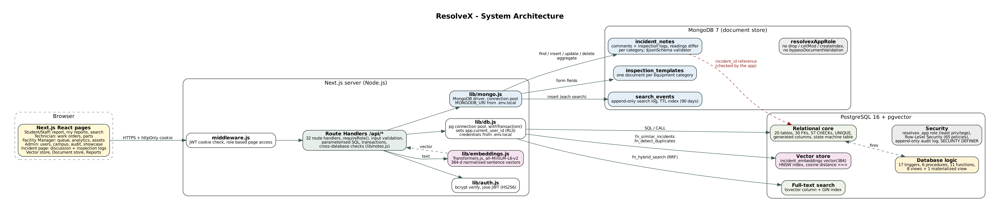

# ResolveX

**An intelligent, database-driven system for campus infrastructure incidents, maintenance and assets.**
DBMS Experiential Learning, Level 3 project. **RDBMS + NoSQL:** PostgreSQL (relational, with pgvector for vectors) and MongoDB (documents), with a Next.js web app.

Students and staff report problems such as a dead AC, a sparking switchboard or a slow Wi-Fi access point in their own words.
ResolveX then does four things:

- It spots when someone has already reported the same problem, using vector similarity.
- It ranks each problem by real urgency. A priority function and trigger inside PostgreSQL do this.
- It assigns the best-suited technician through a stored procedure.
- It records the repair atomically: parts, stock, cost and asset history all change in one transaction.

That history then drives predictive-maintenance risk scores.

The discussion on each incident and the technicians' field inspection logs live in **MongoDB**. Their readings differ for every kind of equipment: an AC log has temperatures and refrigerant pressure, a Wi-Fi log has signal strength and packet loss.



## What is inside

| Area | Highlights |
|---|---|
| Relational design | 20 tables in 3NF, 30 foreign keys, 57 CHECK constraints, UNIQUE / partial-unique / expression indexes, a self-referencing FK, an ISA specialisation, M:N junction tables, generated columns |
| DDL | `CREATE`, `ALTER` (schema evolution in `02_alter.sql`), `DROP` (`00_drop.sql`) |
| Advanced SQL | 17 triggers, 6 stored procedures, 11 functions, 8 views + 1 materialized view, transactions with row locks, window functions, recursive CTE, ROLLUP, full-text search |
| Vector database | `incident_embeddings vector(384)` with an HNSW index (cosine). **Read:** duplicate detection while typing, similar past fixes, hybrid semantic + keyword search (Reciprocal Rank Fusion). **Update:** editing an incident re-embeds it in the same transaction; stale vectors are detected and re-embedded. **Delete / create:** Vector store page (admin), cascade on incident delete |
| RBAC in the database | **Row-Level Security**: 65 policies on 18 tables. The user's role is looked up inside PostgreSQL, so a student cannot change other people's incidents, a technician cannot touch another technician's work order, only admins can delete vectors or read the audit log, and a deactivated user sees nothing, even with the app's own database login |
| NoSQL document store (MongoDB) | 3 collections: `incident_notes` (comments + inspection logs whose readings differ per equipment category), `inspection_templates`, `search_events`. `$jsonSchema` validators (generated from the templates), compound / multikey / partial / text / unique / TTL indexes, full CRUD from the incident page, a read-only query console with `explain()`, 7 aggregation-pipeline reports (`$unwind`, `$group`, `$lookup`, `$objectToArray`), a least-privilege MongoDB role and cross-database consistency checks. See [NOSQL_DESIGN.md](docs/NOSQL_DESIGN.md) |
| Reports | 15 reports: 8 in SQL (JOIN / GROUP BY / HAVING / AVG / SUM) and 7 MongoDB aggregation pipelines, with a period filter and CSV download |
| Web app | Next.js 15 App Router, 32 API route handlers, 4 roles (Student/Staff, Technician, Facility Manager, Admin), 18 pages |
| Security | bcrypt password hashes (enforced by a CHECK; the column is hidden from the app role), httpOnly JWT sessions, role checks in middleware, in every API and in the database (RLS), parameterised SQL and type-checked MongoDB queries, least-privilege roles in both databases, trigger-only audit log, login throttling, secrets in `.env.local` |
| Tests | 121 automated tests: 53 SQL, 27 MongoDB, 41 API/security (`npm run test:db`, `npm run test:nosql`, `npm run test:api`) |

## Quick start

### 1. Requirements
- Node.js 20 or newer
- PostgreSQL 15/16 **with the pgvector extension**, and **MongoDB 6 or newer**. The easiest way to get both is Docker:
  ```bash
  docker compose up -d          # starts pgvector/pgvector:pg16 on 5432 and mongo:7.0 on 27017
  ```
  Port 5432 or 27017 already taken on your laptop (a local PostgreSQL or MongoDB)? Do not edit `docker-compose.yml`.
  Create a file named `.env` containing `DB_PORT=5433` and/or `MONGO_PORT=27018`, and use those ports in the URLs in `.env.local`.
  Without Docker: install PostgreSQL, then pgvector ([instructions](https://github.com/pgvector/pgvector#installation)).
  A hosted Postgres with pgvector such as Supabase or Neon also works; add `DATABASE_SSL=true`.

### 2. Configure
```bash
cp .env.example .env.local     # Windows: copy .env.example .env.local
```
Edit `.env.local`:
- `DATABASE_ADMIN_URL` is the postgres superuser. With Docker the password is `postgres_dev_only` unless you set `POSTGRES_PASSWORD`.
- `APP_DB_PASSWORD` and `DATABASE_URL` are the restricted login the app uses.
- `MONGODB_ADMIN_URI` is the MongoDB root login (Docker password `mongo_dev_only` unless you set `MONGO_ROOT_PASSWORD`).
  `MONGO_APP_PASSWORD` and `MONGODB_URI` are the restricted MongoDB login the app uses (`db:setup` creates it).
- `JWT_SECRET` must be a long random string.

### 3. Install, build the database, run
```bash
npm install
npm run db:setup      # PostgreSQL: database/00..08 + app login; MongoDB: app login, collections, indexes, data; embeddings
npm run dev           # http://localhost:3000
```
The first `db:setup` downloads the embedding model (about 90 MB) into `.model-cache/`. After that, everything runs offline.

### Demo accounts (password `Resolve@123`)
| Role | Email |
|---|---|
| Student / Staff | student@resolvex.edu |
| Technician | tech@resolvex.edu |
| Facility Manager | manager@resolvex.edu |
| Administrator | admin@resolvex.edu |

The login page also has one-click buttons for each role.

## Scripts
| Command | What it does |
|---|---|
| `npm run db:setup` | Drop + recreate all objects in PostgreSQL and MongoDB, load seed data, create both app logins, compute embeddings |
| `npm run db:mongo` | Only the MongoDB part (`scripts/setup-mongo.mjs`) |
| `npm run db:embed` | Embed any incidents that do not have a vector yet |
| `npm run dev` / `npm run build && npm start` | Run the web app (development / production) |
| `npm run test:db` | 53 database tests, each in a rolled-back transaction, written to `docs/TEST_RESULTS_DB.md` |
| `npm run test:nosql` | 27 MongoDB tests (validators, update operators, indexes, TTL, aggregation, privileges, cross-database), written to `docs/TEST_RESULTS_NOSQL.md` |
| `npm run test:api` | 41 API and security tests against a running app, written to `docs/TEST_RESULTS_API.md` |
| `python scripts/generate_seed.py` | Regenerate `database/08_seed.sql` (6 months of realistic history) |
| `python scripts/generate_data_dictionary.py <url>` | Regenerate `docs/DATA_DICTIONARY.md` from the live catalog |
| `python docs/diagrams/make_diagrams.py` | Re-render the ER, schema, architecture and lifecycle diagrams (Graphviz) |
| `python scripts/take_screenshots.py` | Capture the app screenshots in `docs/screenshots` (Playwright) |

## Project structure
```
database/
  00_drop.sql                 DROP (reset)
  01_schema.sql               CREATE TABLE + PK/FK/CHECK/UNIQUE
  02_alter.sql                ALTER TABLE (self FK, tsvector column, extra rules)
  03_indexes.sql              B-tree, composite, partial, expression, GIN, HNSW
  04_functions_procedures.sql priority scoring, risk score, vector + hybrid search, procedures
  05_triggers.sql             validation, automation, state machine, audit
  06_views.sql                dashboard views + materialized view
  07_security.sql             roles, GRANT/REVOKE, SECURITY DEFINER, Row-Level Security policies
  08_seed.sql                 generated seed data
  09_queries.sql              important queries (also run live on the DB showcase page)
  10_viva_live_demo.sql       copy-paste commands for the viva (DDL, DML, triggers, RLS, vector RUD)
  mongodb/schema.mjs          MongoDB design: templates, generated $jsonSchema validators, indexes
  mongodb/live_demo.mongosh.js  copy-paste mongosh commands for the viva (CRUD, validation, indexes, aggregation)
scripts/setup-mongo.mjs       creates the MongoDB app role/login, collections, indexes and data
app/                          Next.js pages (app/(app)/...) and API route handlers (app/api/...)
lib/                          PostgreSQL pool + transactions, MongoDB client, notes rules, auth, embeddings, reports
components/                   shared UI
middleware.js                 session + role based page protection
tests/                        database and API test suites
docs/                         design documents, diagrams, screenshots, test results
```

## Documentation
- [Database design](docs/DATABASE_DESIGN.md): ER diagram, relational schema, normalisation, constraints, indexes, views, triggers, procedures, transactions, security
- [Vector search design](docs/VECTOR_SEARCH.md): what is embedded, the model, storage, similarity metric, retrieval strategy
- [MongoDB design](docs/NOSQL_DESIGN.md): why a document store, collections, validators, indexes, CRUD, aggregation, security, cross-database consistency
- [Data dictionary](docs/DATA_DICTIONARY.md)
- [Requirements checklist](docs/REQUIREMENTS_CHECKLIST.md): every point of the Level 3 brief mapped to where it is implemented
- [Demo script and viva preparation](docs/DEMO_GUIDE.md)
- [Team split and Git workflow](docs/TEAM_SPLIT.md)
- Test results: [SQL database](docs/TEST_RESULTS_DB.md), [MongoDB](docs/TEST_RESULTS_NOSQL.md), [API](docs/TEST_RESULTS_API.md)

## Team
| Member | SRN | Responsibilities |
|---|---|---|
| Member 1: Sonu Akash Soundararajan | PES1UG24AM908 | Incidents, priority engine, vector search, reporting and search UI (see docs/TEAM_SPLIT.md) |
| Member 2: Rishit V N S | PES1UG24AM225 | Work orders, inventory transactions, analytics and predictive maintenance, admin and security |
