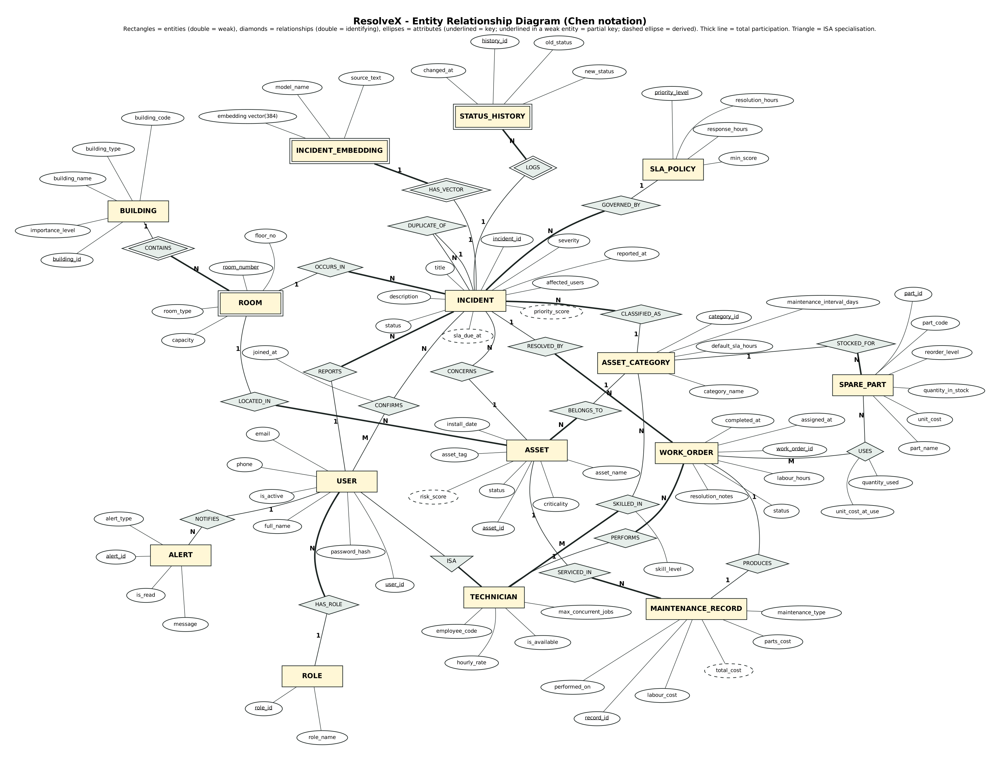
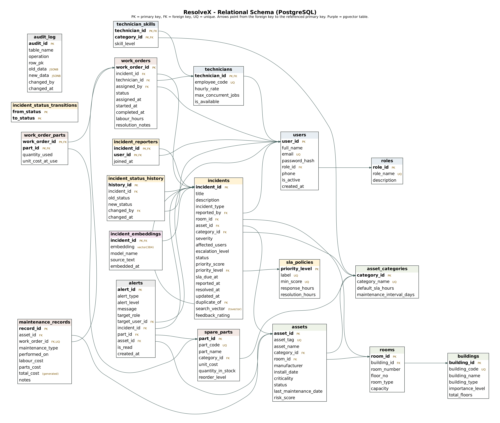
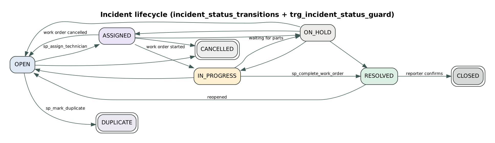

# ResolveX: database design

## 1. Why two database paradigms

The data ResolveX handles comes in two different shapes, and each shape goes to the store that suits it.

| Data | Shape | Store | Why |
|---|---|---|---|
| Users, roles, buildings, rooms, assets, work orders, spare parts, costs, SLA policies | Highly structured, strongly related, must never contradict itself (stock cannot go negative; a repair must update stock, cost and status together) | **PostgreSQL relational tables** | Foreign keys, CHECK constraints, triggers and ACID transactions guarantee integrity. Joins, aggregates and views answer the operational questions. |
| What people write when they report a problem ("AC blowing warm air", "room is too hot") | Unstructured free text. The same fault is described in very different words | **pgvector** (`incident_embeddings`, `vector(384)`, HNSW index) | Keyword search cannot see that "room is too hot" and "AC not cooling" are the same problem. Sentence embeddings place them close together, so cosine similarity finds duplicates and past fixes. |

Both live in one PostgreSQL server. The vector table is joined to the relational tables in the same SQL query: similarity, location, status and the fix that worked come back together. With a separate vector product, that would need two systems and application-side joins.

## 2. ER diagram



### Entities

| Entity | Type | Key | Notes |
|---|---|---|---|
| USER | strong | user_id | email unique, bcrypt password hash |
| ROLE | strong | role_id | 4 roles |
| TECHNICIAN | specialisation of USER (ISA) | user_id (shared) | disjoint, partial: only some users are technicians |
| BUILDING | strong | building_id | importance level feeds priority |
| ROOM | weak (owner BUILDING) | building + room_number | implemented with surrogate `room_id` plus `UNIQUE(building_id, room_number)` |
| ASSET_CATEGORY | strong | category_id | also used as incident category and skill area |
| ASSET | strong | asset_id | derived attribute risk_score |
| INCIDENT | strong | incident_id | derived attributes priority_score, priority_level, sla_due_at |
| SLA_POLICY | strong | priority_level | P1-P4 |
| INCIDENT_EMBEDDING | weak (owner INCIDENT, 1:1) | incident_id | the vector store |
| STATUS_HISTORY | weak (owner INCIDENT) | incident + history_id | written by trigger |
| WORK_ORDER | strong | work_order_id | |
| SPARE_PART | strong | part_id | |
| MAINTENANCE_RECORD | strong | record_id | derived total_cost |
| ALERT | strong | alert_id | written by triggers / procedures |

### Relationships and cardinalities

| Relationship | Between | Cardinality | Participation | Attributes |
|---|---|---|---|---|
| HAS_ROLE | USER - ROLE | N:1 | every user has a role (total) | |
| ISA | USER - TECHNICIAN | specialisation | partial | |
| SKILLED_IN | TECHNICIAN - ASSET_CATEGORY | M:N | total on technician | skill_level |
| CONTAINS (identifying) | BUILDING - ROOM | 1:N | total on room | |
| LOCATED_IN | ASSET - ROOM | N:1 | total on asset | |
| BELONGS_TO | ASSET - ASSET_CATEGORY | N:1 | total on asset | |
| REPORTS | USER - INCIDENT | 1:N | total on incident | |
| CONFIRMS | USER - INCIDENT | M:N | partial | joined_at |
| OCCURS_IN | INCIDENT - ROOM | N:1 | total on incident | |
| CONCERNS | INCIDENT - ASSET | N:1 | partial (asset optional) | |
| CLASSIFIED_AS | INCIDENT - ASSET_CATEGORY | N:1 | total on incident | |
| GOVERNED_BY | INCIDENT - SLA_POLICY | N:1 | total on incident | |
| DUPLICATE_OF (recursive) | INCIDENT - INCIDENT | N:1 | partial | |
| HAS_VECTOR (identifying) | INCIDENT - INCIDENT_EMBEDDING | 1:1 | total on embedding | |
| LOGS (identifying) | INCIDENT - STATUS_HISTORY | 1:N | total on history | |
| RESOLVED_BY | INCIDENT - WORK_ORDER | 1:N | total on work order | |
| PERFORMS | TECHNICIAN - WORK_ORDER | 1:N | total on work order | |
| USES | WORK_ORDER - SPARE_PART | M:N | partial | quantity_used, unit_cost_at_use |
| STOCKED_FOR | SPARE_PART - ASSET_CATEGORY | N:1 | total on part | |
| PRODUCES | WORK_ORDER - MAINTENANCE_RECORD | 1:1 | partial | |
| SERVICED_IN | ASSET - MAINTENANCE_RECORD | 1:N | total on record | |
| NOTIFIES | ALERT - USER | N:1 | partial (or a role) | |

## 3. ER to relational mapping

| ER construct | Mapping rule applied | Result |
|---|---|---|
| Strong entity | own table, key becomes PK | users, buildings, assets, incidents, ... |
| Weak entity ROOM | table with owner's key as FK; partial key + owner key unique | `rooms(building_id FK, room_number, UNIQUE(building_id, room_number))` |
| ISA (USER, TECHNICIAN) | subclass table shares the superclass PK | `technicians.technician_id` is both PK and FK to `users`; trigger checks the user's role |
| 1:N | FK on the N side | `incidents.reported_by`, `assets.room_id`, `work_orders.technician_id` ... |
| 1:1 | FK with UNIQUE (or shared PK) | `incident_embeddings.incident_id` PK+FK; `maintenance_records.work_order_id UNIQUE` |
| M:N | junction table, composite PK, relationship attributes as columns | `technician_skills`, `incident_reporters`, `work_order_parts` |
| Recursive N:1 | self-referencing FK | `incidents.duplicate_of -> incidents.incident_id` (added with ALTER TABLE) |
| Derived attribute | stored and maintained by trigger / generated column, or computed in a view | `priority_score`, `sla_due_at` (trigger), `total_cost` (GENERATED), `risk_score` (function) |

## 4. Relational schema

Primary keys are in **bold**; foreign keys are marked with an arrow.



```
roles(**role_id**, role_name UQ, description)
users(**user_id**, full_name, email UQ, password_hash, role_id -> roles, phone, is_active, created_at)
technicians(**technician_id** -> users, employee_code UQ, hourly_rate, max_concurrent_jobs, is_available)
technician_skills(**technician_id** -> technicians, **category_id** -> asset_categories, skill_level)
buildings(**building_id**, building_code UQ, building_name, building_type, importance_level, total_floors)
rooms(**room_id**, building_id -> buildings, room_number, floor_no, room_type, capacity, UQ(building_id, room_number))
asset_categories(**category_id**, category_name UQ, default_sla_hours, maintenance_interval_days)
assets(**asset_id**, asset_tag UQ, asset_name, category_id -> asset_categories, room_id -> rooms, manufacturer,
       install_date, criticality, status, last_maintenance_date, risk_score)
sla_policies(**priority_level**, label UQ, min_score UQ, response_hours, resolution_hours)
incident_status_transitions(**from_status**, **to_status**)
incidents(**incident_id**, title, description, incident_type, reported_by -> users, room_id -> rooms,
          asset_id -> assets, category_id -> asset_categories, severity, affected_users, escalation_level, status,
          priority_score, priority_level -> sla_policies, sla_due_at, reported_at, resolved_at, updated_at,
          duplicate_of -> incidents, search_vector, feedback_rating)
incident_embeddings(**incident_id** -> incidents, embedding vector(384), model_name, source_text, embedded_at)
incident_reporters(**incident_id** -> incidents, **user_id** -> users, joined_at)
incident_status_history(**history_id**, incident_id -> incidents, old_status, new_status, changed_by -> users, changed_at)
work_orders(**work_order_id**, incident_id -> incidents, technician_id -> technicians, assigned_by -> users, status,
            assigned_at, started_at, completed_at, labour_hours, resolution_notes)
spare_parts(**part_id**, part_code UQ, part_name, category_id -> asset_categories, unit_cost, quantity_in_stock, reorder_level)
work_order_parts(**work_order_id** -> work_orders, **part_id** -> spare_parts, quantity_used, unit_cost_at_use)
maintenance_records(**record_id**, asset_id -> assets, work_order_id -> work_orders UQ, maintenance_type, performed_on,
                    labour_cost, parts_cost, total_cost GENERATED, notes)
alerts(**alert_id**, alert_type, alert_level, message, target_role, target_user_id -> users, incident_id -> incidents,
       part_id -> spare_parts, asset_id -> assets, is_read, created_at)
audit_log(**audit_id**, table_name, operation, row_pk, old_data JSONB, new_data JSONB, changed_by, changed_at)
```

Full column types, nullability, defaults and every CHECK are in the [data dictionary](DATA_DICTIONARY.md).

## 5. Normalisation

- **1NF.** Every column is atomic. Repeating groups became their own tables: a technician's skills (`technician_skills`), the parts used in a repair (`work_order_parts`), and the people who confirmed an incident (`incident_reporters`). Nothing is stored as a comma list.
- **2NF.** Every table with a composite key has no partial dependency. For example, in `work_order_parts(work_order_id, part_id, quantity_used, unit_cost_at_use)` the quantity depends on the pair. `unit_cost_at_use` is the price at the moment of use, so it also depends on the pair, not on `part_id` alone: the current price can change later.
- **3NF / BCNF.** No non-key attribute depends on another non-key attribute. An incident stores `room_id` only, never the building: the building is reached through `rooms`, which avoids the transitive dependency `incident -> room -> building`. Category facts (`default_sla_hours`, `maintenance_interval_days`) live once in `asset_categories`. Every determinant is a candidate key: `email` and `asset_tag` are keys and declared UNIQUE.
- **Controlled, documented redundancy.** A few derived values are stored on purpose, and each one is maintained by the database itself so it cannot drift:
  - `incidents.priority_level` and `sla_due_at` are set by `trg_incident_priority`. They are stored because the deadline promised when the problem was reported must not move if an admin later edits the SLA policy. They are also indexed (`idx_incidents_active_sla`).
  - `maintenance_records.total_cost` is a `GENERATED ALWAYS` column.
  - `assets.risk_score` is a cache refreshed by `fn_asset_risk_score`. The view `v_asset_health` always recomputes it live.

## 6. DDL (CREATE / ALTER / DROP)

| File | Statements |
|---|---|
| `00_drop.sql` | `DROP MATERIALIZED VIEW / VIEW / TABLE / FUNCTION / PROCEDURE ... CASCADE` in reverse dependency order |
| `01_schema.sql` | `CREATE EXTENSION vector, pgcrypto`; 20 × `CREATE TABLE` with PK, FK (`ON DELETE CASCADE / SET NULL / RESTRICT` chosen per relationship), NOT NULL, UNIQUE, CHECK, DEFAULT, GENERATED |
| `02_alter.sql` | `ALTER TABLE ... ADD COLUMN` (self FK, tsvector, risk score, feedback), `ADD CONSTRAINT` (FK + 4 CHECKs), `ALTER COLUMN SET DEFAULT`, `RENAME COLUMN`, `DROP COLUMN` |
| `03_indexes.sql` | `CREATE INDEX` / `CREATE UNIQUE INDEX` (B-tree, composite, partial, expression, GIN, HNSW) |

Foreign key actions were chosen per relationship:
- **CASCADE**: rooms of a deleted building; embeddings, history and work orders of a deleted incident.
- **SET NULL**: an incident's asset if the asset is deleted; `assigned_by` if the user is removed.
- **RESTRICT / no action**: a room that still has assets; a spare part already used in repairs, which protects cost history (test T29b).

## 7. Constraints for data validation (requirement 12)

Validation happens in the database, so no client (the app, psql, a script) can store bad data.

- **CHECK (57):** email and phone formats; the password must look like a bcrypt hash; severity 1-5; stock ≥ 0; resolved time ≥ reported time; status values; `RESOLVED/CLOSED ⇔ resolved_at IS NOT NULL`; `DUPLICATE ⇔ duplicate_of IS NOT NULL`; a feedback rating only after resolution; asset tag pattern; SLA resolution ≥ response.
- **UNIQUE:** emails (plus a case-insensitive expression index), asset tags, part codes, room number per building, at most one active work order per incident (partial unique index).
- **Triggers (cross-table rules a CHECK cannot express):**
  - the asset must be in the selected room and of the same category;
  - no new incidents on decommissioned assets;
  - inactive users cannot report;
  - only legal status transitions are allowed (state machine table);
  - a technician row must belong to a TECHNICIAN user;
  - a technician must have the skill and spare capacity;
  - a reporter cannot confirm their own incident.



## 8. Indexes

| Index | Type | Serves |
|---|---|---|
| `idx_incidents_status_priority (status, priority_score DESC)` | composite B-tree | manager queue `WHERE status = ... ORDER BY priority_score DESC` |
| `idx_incidents_active_sla (sla_due_at) WHERE status IN (active)` | partial | SLA escalation and overdue counts; small because closed incidents are excluded |
| `uq_one_active_work_order (incident_id) WHERE status IN ('ASSIGNED','IN_PROGRESS')` | partial unique | business rule: one active job per incident |
| `uq_users_email_lower (lower(email))` | expression unique | case-insensitive login lookup |
| `idx_incidents_fts (search_vector)` | GIN | full-text keyword search |
| `idx_incident_embeddings_hnsw (embedding vector_cosine_ops)` | HNSW (pgvector) | approximate nearest-neighbour similarity search |
| `idx_audit_new_data (new_data jsonb_path_ops)` | GIN | searching inside audit snapshots |
| FK indexes (`idx_assets_room`, `idx_incidents_room`, `idx_wo_technician_status`, ...) | B-tree | joins and per-technician workload |

`EXPLAIN` of the queue query (showcase query q15) shows an index scan instead of a sequential scan.

## 9. Views

| View | Purpose | SQL features |
|---|---|---|
| `v_incident_details` | one row per incident for every list and detail page | 7 joins, LEFT JOIN LATERAL (latest work order), correlated subquery |
| `v_critical_incidents` | P1/P2 or overdue active incidents | view on a view |
| `v_technician_workload` | active / completed jobs, turnaround, utilisation | `COUNT(*) FILTER`, AVG of intervals, GROUP BY |
| `v_asset_health` | predictive maintenance: failures, MTBF, predicted next failure, risk band | CTEs, `LAG()` window function, function call |
| `v_maintenance_cost_summary` | cost per month / building / category | `date_trunc`, GROUP BY |
| `v_sla_compliance` | % resolved within SLA per priority | conditional aggregation |
| `v_low_stock_parts` | parts at or below reorder level | |
| `v_embedding_status` | vector store health: FRESH / STALE (text changed after embedding) / MISSING | LEFT JOIN, `vector_dims`, `vector_norm`, CASE |
| `mv_monthly_incident_stats` | monthly trend (materialized; refreshed concurrently) | unique index enables `REFRESH ... CONCURRENTLY` |

## 10. Functions and stored procedures

| Object | Kind | What it does |
|---|---|---|
| `fn_priority_breakdown` | function (table) | 7 weighted factors: severity, people affected (log scale), asset criticality, location importance, repeat failures in 90 days, category urgency, SLA escalation |
| `fn_priority_score` / `fn_priority_level` | function | sum of factors capped at 100 (severity 5 never below 70); score → P1-P4 via `sla_policies` |
| `fn_asset_risk_score` | function | failures in 180 days + overdue-ness vs maintenance interval + age + criticality |
| `fn_similar_incidents` | function (table) | k nearest incidents by cosine distance, with location and the fix that worked |
| `fn_detect_duplicates` | function (table) | active incidents of the last 14 days, similarity boosted when asset / room / building match |
| `fn_hybrid_search` | function (table) | vector search + full-text search fused by Reciprocal Rank Fusion |
| `fn_current_app_user` | function | reads the acting user id set per transaction (used by audit and history triggers) |
| `fn_refresh_monthly_stats` | function, SECURITY DEFINER | lets the restricted app role refresh the materialized view |
| `fn_current_app_role` | function, SECURITY DEFINER | role of the logged-in user, looked up from `users` (used by every RLS policy) |
| `fn_login_lookup` | function, SECURITY DEFINER | returns one user's bcrypt hash for login; the app role cannot read the hash column itself |
| `sp_assign_technician` | procedure | locks the incident, picks the best skilled, least loaded technician (`FOR UPDATE`), creates the work order |
| `sp_complete_work_order` | procedure | the core transaction (section 12) |
| `sp_mark_duplicate` | procedure | recursive CTE finds the root original, links the duplicate, adds the reporter as co-reporter |
| `sp_escalate_overdue` | procedure | escalates incidents past their SLA (max once per 12 h, level ≤ 3) and alerts managers |
| `sp_schedule_preventive_maintenance` | procedure | recomputes risk; raises preventive incidents for high-risk assets |
| `sp_restock_part` | procedure | validated restock |

## 11. Triggers

| Trigger | Timing | Effect |
|---|---|---|
| `trg_incident_validate` | BEFORE INSERT/UPDATE incidents | cross-table validation (asset/room/category, decommissioned, inactive user) |
| `trg_incident_priority` | BEFORE INSERT/UPDATE OF severity, affected_users, ... | computes score, level and SLA deadline |
| `trg_incident_status_guard` | BEFORE UPDATE incidents | state machine; sets / clears resolved_at |
| `trg_incident_status_log` | AFTER INSERT/UPDATE OF status | writes status history; notifies the reporter |
| `trg_incident_reporter_guard` | BEFORE INSERT incident_reporters | no self-confirmation; only active incidents |
| `trg_incident_reporter_count` | AFTER INSERT/DELETE incident_reporters | affected_users ± 1, which chains into the priority trigger |
| `trg_technician_role` | BEFORE INSERT/UPDATE technicians | ISA integrity |
| `trg_work_order_validate` | BEFORE INSERT work_orders | skill, availability, job limit |
| `trg_work_order_assigned_alert` | AFTER INSERT work_orders | notifies the technician |
| `trg_work_order_sync` | AFTER UPDATE OF status work_orders | incident and asset follow the work order (in progress, resolved, cancelled) |
| `trg_low_stock_alert` | AFTER UPDATE OF quantity_in_stock | alert when stock crosses the reorder level |
| `trg_audit_*` (6 tables) | AFTER INSERT/UPDATE/DELETE | JSONB before/after audit with the acting user, password hash stripped |

## 12. Transactions and concurrency

`sp_complete_work_order` runs in one transaction (`lib/db.js → withTransaction`):

1. `SELECT ... FOR UPDATE` on the work order. It checks the owner and the state.
2. For each part: `SELECT ... FOR UPDATE` on the part row. If stock is short it raises an exception. Otherwise it inserts the usage at today's price and deducts stock, which may fire the low-stock alert.
3. Labour cost is hours × the technician's rate. It inserts the maintenance record; `total_cost` is generated.
4. The work order is set to COMPLETED. A trigger resolves the incident and returns the asset to OPERATIONAL, and another trigger writes history and notifies the reporter.

Any failure rolls back every step. Screenshot 13 and test T23 show this: asking for 99 units of a part with 25 in stock leaves the stock, the work order and the incident unchanged. Row locks stop two technicians from consuming the same last unit, and stop two managers from double-assigning one incident. The partial unique index is a second guard against double assignment.

Every API transaction first runs `SELECT set_config('app.current_user_id', <id>, true)`. Triggers therefore know who made the change without trusting anything the client sends.

## 13. Security and role-based access control in the database

### Privileges
- **Least privilege.** The web app connects as a login that belongs to `resolvex_app`. That role has DML and EXECUTE only: no DDL, and no writes to `roles` or the state machine.
- **Password hashes are hidden.** The app role has column-level SELECT on `users` without `password_hash`. Login reads one hash through the SECURITY DEFINER function `fn_login_lookup`. A CHECK constraint rejects anything that is not a bcrypt hash.
- **History cannot be forged.** `audit_log` and `incident_status_history` are written only by SECURITY DEFINER trigger functions. The app role has no INSERT, UPDATE or DELETE on them.
- **SQL injection:** only parameterised statements (`$1, $2`). The showcase page runs its fixed queries inside `BEGIN TRANSACTION READ ONLY`.

### Row-Level Security (65 policies on 18 tables)
Every API request runs its SQL inside a transaction that first sets `app.current_user_id` (`lib/db.js`). The policies call `fn_current_app_role()`, which looks the role up in the `users` table, so the role is never trusted from the client. A deactivated user gets no role.

| Rule | Tables | Effect |
|---|---|---|
| Logged-in, active users only | all 18 | no user, or a deactivated user → zero rows |
| Master data is admin-only | users, buildings, rooms, asset_categories, sla_policies, technician_skills | INSERT / UPDATE / DELETE only for ADMIN |
| Report only in your own name | incidents | INSERT requires `reported_by = current user` |
| Change only what is yours | incidents | UPDATE: the reporter, a technician with a work order on it, or a manager / admin |
| Technicians own their jobs | work_orders | UPDATE: the assigned technician or a manager; INSERT: managers only |
| Inventory | spare_parts, assets, work_order_parts, maintenance_records | students cannot change them; delete is admin-only |
| Vector store | incident_embeddings | INSERT / UPDATE (re-embed): the reporter or a manager; DELETE: admin only |
| Confirmations | incident_reporters | add or withdraw only your own |
| Private notifications | alerts | see, mark and delete only alerts for you or your role |
| Audit trail | audit_log | readable by ADMIN only |

Triggers that act on behalf of the system are SECURITY DEFINER, so they keep working under RLS. One example is the "me too" counter updating someone else's incident. Proof: tests T36-T47; showcase query q22 lists every policy; section 10 of `database/10_viva_live_demo.sql` shows it live in psql.

## 14. DML coverage

| Operation | Where |
|---|---|
| INSERT | report incident (+ embedding), confirm incident, create user (+ technician + skills), add asset / part / building / room, work order (procedure), parts used, maintenance record, alerts, audit rows |
| UPDATE | edit an incident's text + re-embed its vector, status changes, close / reopen / feedback, severity re-classification, start / hold / resume work, stock deduction and restock, SLA policy edits, user activation, technician availability, escalation |
| DELETE | withdraw a confirmation (`incident_reporters`, trigger lowers affected users), delete read notifications (`alerts`), delete a vector (`incident_embeddings`, admin), delete an unused spare part (refused by the FK if the part was used), seed rebuild of history |
| SELECT | every page; joins, GROUP BY / HAVING, ORDER BY, aggregates, subqueries, window functions, CTEs, ROLLUP (see `database/09_queries.sql`) |
