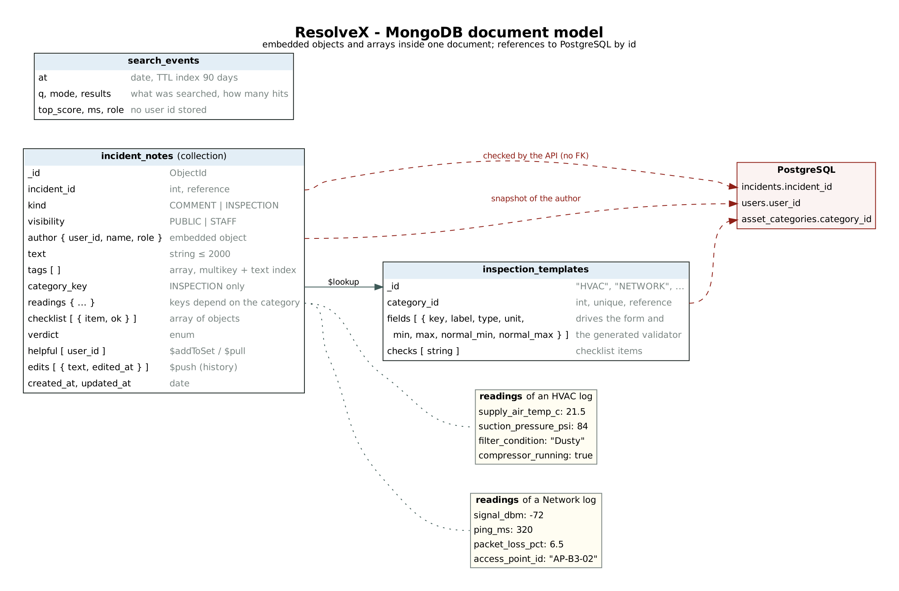

# ResolveX: MongoDB (NoSQL document store) design

ResolveX uses **three data models**, each for the data it suits:

| Store | Data | Why this store |
|---|---|---|
| **PostgreSQL** (relational) | users, roles, campus, assets, incidents, work orders, parts, costs, SLA | Fixed structure, foreign keys, CHECKs, triggers and ACID transactions. Money and stock must never be inconsistent. |
| **pgvector** (vector) | one 384-d embedding per incident | Meaning-based similarity search ([VECTOR_SEARCH.md](VECTOR_SEARCH.md)). |
| **MongoDB 7** (document, NoSQL) | incident discussion threads, technicians' field inspection logs, inspection templates, the search log | Semi-structured data whose **shape changes from one document to the next**, nested arrays, and an append-only log that expires on its own. |



## 1. Why a document store for this data

**Inspection readings differ for every equipment category.** An HVAC technician records supply-air temperature, suction pressure and filter condition. A network technician records Wi-Fi signal in dBm, ping and packet loss. A lift technician records door faults and levelling error. There are 9 categories with 38 different reading fields and 36 checklist items.

In PostgreSQL this would need one of the following:

| Relational option | Problem |
|---|---|
| One table with 39 nullable columns | Most columns are NULL in every row. A new reading means `ALTER TABLE`. |
| Entity-attribute-value table `(note_id, key, value TEXT)` | Values lose their type (a number is stored as text), ranges cannot be checked, and every read needs a pivot. |
| One table per category (9 tables) | 9 near-identical tables; a query across categories needs 9 `UNION`s. |

In MongoDB each inspection document carries exactly the readings it has, with their real types, and the collection still enforces the rules (section 3).

**The rest of the note is nested too:** a checklist is an array of `{ item, ok }`, tags are an array, helpful votes are an array of user ids, and the edit history is an array of previous versions. A note is always read and written as **one unit** (the whole thread of one incident), so embedding them in one document means one read, and every update is atomic on that document.

**The search log** is append-only, high-volume and only useful for a while. A **TTL index** makes MongoDB delete events older than 90 days automatically.

**What stays in PostgreSQL, and why:** incidents, work orders, stock and costs need multi-table transactions, foreign keys and row-level security. A repair must deduct stock, record cost and resolve the incident together or not at all. MongoDB is not used for any of that.

## 2. Collections

### `incident_notes` (345 seeded documents: 192 comments, 153 inspection logs)

```json
{
  "_id": { "$oid": "6addfecd29bbd119a758bdd4" },
  "incident_id": 166,                                       // reference to PostgreSQL incidents
  "kind": "INSPECTION",                                     // or "COMMENT"
  "visibility": "STAFF",                                    // STAFF notes are hidden from students
  "author": { "user_id": 10, "name": "Lakshmi Prasad", "role": "TECHNICIAN" },
  "text": "Supply air only 23.9 °C at 64 psi suction: refrigerant low, leak suspected at the flare joint.",
  "tags": ["refrigerant", "gas-leak"],
  "category_key": "HVAC",                                   // which template the readings follow
  "readings": { "supply_air_temp_c": 23.9, "room_temp_c": 31.8, "suction_pressure_psi": 64,
                "filter_condition": "Clean", "compressor_running": true },
  "checklist": [ { "item": "Filter clean", "ok": true }, { "item": "Drain line clear", "ok": true }, ... ],
  "verdict": "NEEDS_PARTS",
  "helpful": [2, 5],                                        // who found it helpful ($addToSet / $pull)
  "edits": [ { "text": "previous version", "edited_at": { "$date": "..." } } ],
  "created_at": { "$date": "2026-10-24T09:12:00Z" }, "updated_at": { "$date": "..." }
}
```

A network inspection in the **same collection** has `readings: { signal_dbm, ping_ms, packet_loss_pct, clients_connected, access_point_id }` instead.

### `inspection_templates` (9 documents, one per `asset_categories` row)

`{ _id: "HVAC", category_id: 1, category_name, fields: [ { key, label, type, unit, min, max, normal_min, normal_max } ], checks: [ ... ] }`

The template drives three things:
- The inspection form on the incident page is built from it, so adding a field needs no code change.
- The collection validator is **generated** from it (section 3).
- The "abnormal readings" report joins to it with `$lookup` to compare readings with their healthy range.

### `search_events` (260 seeded, plus one per search)

`{ at, q, mode, results, top_score, ms, role }`. The user's role is stored, but not their id, to protect privacy.

## 3. Validation: `$jsonSchema` validators (`validationLevel: strict`, `validationAction: error`)

MongoDB rejects any insert or update that breaks these rules (error 121, "Document failed validation"):

| Rule | How |
|---|---|
| Required fields | `required: [incident_id, kind, visibility, author, text, created_at]` |
| Types and enums | `incident_id` is `int ≥ 1`; `kind` ∈ COMMENT / INSPECTION; `visibility` ∈ PUBLIC / STAFF; `author.role` ∈ the 4 roles; dates are `date` |
| Text and tags | text 1–2000 characters; tags: at most 8, unique, lower-case slugs (`^[a-z0-9-]{2,24}$`) |
| A comment cannot carry readings | `oneOf` branch: COMMENT + `not: { anyOf: [ required readings / checklist / verdict ] }` |
| **Readings must match the category** | One `oneOf` branch per template, **generated** from `inspection_templates`. For example, the HVAC branch allows only the 5 HVAC keys (`additionalProperties: false`), each with its type and range: `supply_air_temp_c` is a number in 0–45, `filter_condition` must be Clean, Dusty or Blocked, `compressor_running` must be a bool. |
| Only staff write inspections | `author.role` in each inspection branch ∈ TECHNICIAN / FACILITY_MANAGER / ADMIN |
| Checklist items | Must be one of that category's checks; `ok` is a bool |

The API checks the same rules first (`lib/notes.js`), so the user gets a clear message. The validator is the last line of defence, like CHECK constraints in PostgreSQL.

## 4. Indexes

| Index | Keys | Type | Used by |
|---|---|---|---|
| `ix_incident_thread` | `{ incident_id: 1, created_at: -1 }` | compound | the thread on the incident page (explain: IXSCAN, documents examined = returned) |
| `ix_author` | `{ "author.user_id": 1, created_at: -1 }` | compound, on an embedded field | a user's own notes, technician activity |
| `ix_tags` | `{ tags: 1 }` | **multikey** (one entry per array element) | "notes tagged leak" |
| `ix_inspection_verdict` | `{ category_key: 1, verdict: 1 }` | **partial** (`kind: "INSPECTION"` only) | inspection queries; comments are not indexed |
| `tx_note_text` | `{ text: "text", tags: "text" }`, tags weight 3 | **text** | `$text` search ranked by `textScore` |
| `uq_category_id` | `inspection_templates { category_id: 1 }` | **unique** | one template per category |
| `ttl_search_events` | `search_events { at: 1 }`, `expireAfterSeconds: 7776000` | **TTL** | automatic deletion after 90 days |
| `ix_mode_time` | `search_events { mode: 1, at: -1 }` | compound | search analytics |

## 5. CRUD on the documents

| Operation | In the app | MongoDB call | Who may do it |
|---|---|---|---|
| **Create** | Post a comment; save an inspection log; every search | `insertOne` | anyone who can see the incident (comments); the technician with a work order on it, or a manager (inspections); students only PUBLIC |
| **Read** | thread on the incident page; Document store query console; 7 reports | `find` + sort (index), `$text`, `aggregate` | students: PUBLIC notes only; staff: all |
| **Update** | Edit your comment (old text kept); Helpful vote | `findOneAndUpdate` with `$set` + `$push` (with `$slice` -50); `$addToSet` / `$pull` | the author only (edit); anyone except the author (vote) |
| **Delete** | Delete a note; admin cleanup of orphaned notes | `deleteOne`, `deleteMany` | the author, or a facility manager / admin |

Each update touches **one document**, so it is atomic without a multi-document transaction.

## 6. Aggregation pipelines (Reports page, "MongoDB" group)

| Report | Stages |
|---|---|
| Most failed inspection checks by category | `$match` → `$unwind: "$checklist"` → `$group` with `$sum: { $cond }` → `$project` (failure %) → `$sort` → `$limit` |
| Abnormal readings found during inspections | `$lookup` (join to `inspection_templates`) → `$unwind` → `$objectToArray: "$readings"` → `$unwind` → `$filter` (find the field's definition) → `$match` with `$expr` (below `normal_min` or above `normal_max`) → `$group` (`$avg`, `$min`, `$max`) |
| Inspection verdicts per category | `$group` with conditional `$sum`, a pivot like `COUNT(*) FILTER` in SQL |
| Most discussed incidents | `$group`, `$addToSet` + `$size` (distinct participants), `$max`. **Incident titles come from PostgreSQL** with one `WHERE incident_id = ANY($1)` (an application-side join). |
| Technician field activity | `$match` on an embedded field, `$size` of the helpful array |
| What people search for | `search_events`: `$group` by text, searches with 0 results; shows what users need but cannot find |
| Search usage by mode and role | `$group` on two keys |

Each report has a period filter, CSV download and **Show the pipeline** (the exact `db.collection.aggregate([...])` text).

## 7. Security

| Measure | Detail |
|---|---|
| No hard-coded credentials | `MONGODB_URI` / `MONGODB_ADMIN_URI` in `.env.local` (git-ignored); `.env.example` has placeholders |
| Least privilege | `db:setup` (as root) creates the role **`resolvexAppRole`** and the login `resolvex_app`. Its privileges: notes `find/insert/update/remove`; search_events `find/insert` (**append-only**); templates `find` (**read-only**); plus `listCollections`, `listIndexes`, `collStats`, `dbStats`. It **cannot** drop collections, create indexes, `collMod` (switch the validator off), `bypassDocumentValidation`, create users, or read other databases. Test N24 tries all eight and each is denied. |
| No row-level security in MongoDB, so the API enforces it | Before every read or write of a note, `lib/notes.js` loads the incident from **PostgreSQL under RLS**. Students get `{ visibility: "PUBLIC" }` added to every filter. Edit and delete filters include `"author.user_id": me`, so an update cannot hit someone else's note even in a race. |
| NoSQL injection | Request values are type-checked (`v.str`, `v.int`) before they reach a query, so `{"$gt": ""}` as a comment is rejected (A37). Note ids must be 24-hex ObjectIds. The query console parses Extended JSON and rejects `$where`, `$function`, `$accumulator`, `$out` and `$merge` (server-side JavaScript or writes), only allows the 3 collections, has a limit ≤ 50, and runs with `maxTimeMS` 3000. |
| Privacy | `search_events` stores the role, not the user. The browser never receives the list of voter ids (only a count and "did I vote"). |

## 8. Consistency between the two databases

There is no foreign key from MongoDB to PostgreSQL. ResolveX handles that as follows:

1. **Check on write.** A note is inserted only after the incident is found in PostgreSQL (404 otherwise, test A38).
2. **Snapshot on purpose.** `author.name` is copied into the note: it records who wrote it at that time, like a signature, and the thread needs no join to show it.
3. **Detect and repair.** On the Document store page, *Check references* lists notes whose incident no longer exists (for example after a delete done directly in psql). An admin can remove them (`deleteMany`). Tests N25–N27 verify that every note's incident exists, each inspection's category matches its incident, and each seeded inspection's author has a work order on that incident.
4. **Failure isolation.** If MongoDB is down, only the notes panel and the MongoDB reports show "document store not reachable" (HTTP 503). Reporting, assigning, completing work orders and search keep working, and the driver reconnects by itself when MongoDB is back.

## 9. Evidence

- `npm run test:nosql`: 27 tests (N01–N27), results in [TEST_RESULTS_NOSQL.md](TEST_RESULTS_NOSQL.md). They cover validators, update operators, index use (explain), TTL, aggregations, privileges and cross-database checks.
- `npm run test:api`: A29–A41 cover the notes API: visibility, RBAC, template validation, edit history, votes, delete, injection, the Document store page and the search log.
- `database/mongodb/live_demo.mongosh.js`: copy-paste commands for the viva (create, read, update, delete, a validator rejection, indexes and explain, aggregation, privileges).
- Screenshots 26–31 in `docs/screenshots/`.
